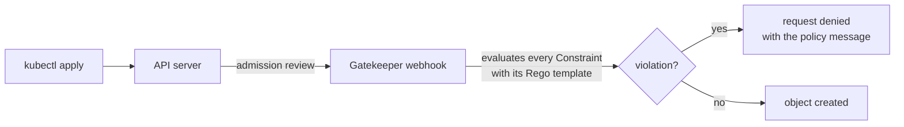

# OPA Gatekeeper Lab


Five Kubernetes admission policies written in Rego for OPA Gatekeeper, each with a manifest that breaks it and a script that proves the cluster rejects that manifest.

## Policies

| Policy | Rejects | Applies to |
|---|---|---|
| `no-nodeport` | Services of type `NodePort` | all namespaces except `kube-system`, `kube-flannel` and `gatekeeper-system` |
| `no-latest-tag` | containers whose image ends with `:latest` | all namespaces except `kube-system`, `kube-flannel` and `gatekeeper-system` |
| `no-privileged` | containers with `privileged: true` | all namespaces except `kube-system`, `kube-flannel` and `gatekeeper-system` |
| `require-limits` | Pods with a container that has no CPU or memory limit | Pods in `prod` |
| `run-as-non-root` | Pods with a container that does not run as non-root (`runAsNonRoot: true` on the container, or on the Pod without a container override) | Pods in `prod` |

The system namespaces are excluded because kube-proxy and Flannel run privileged containers.

## How it works



Each policy is a pair of files:

- **`template.yaml`** (ConstraintTemplate): the Rego rule, and the name of the CRD that Gatekeeper generates from it.
- **`constraint.yaml`** (Constraint): an instance of that CRD that sets the scope (kinds, namespaces) and `enforcementAction: deny`.

## Repository layout

```text
policies/<policy>/template.yaml     # Rego rule (ConstraintTemplate)
policies/<policy>/constraint.yaml   # scope and enforcement (Constraint)
tests/<policy>.yaml                 # a manifest that must be rejected
scripts/install-gatekeeper.sh       # installs Gatekeeper v3.14.2 and waits for it
scripts/apply-policies.sh           # applies templates, waits for their CRDs, applies constraints
scripts/test-policies.sh            # checks that every test manifest is rejected
cluster-k8s-shell/create-cluster.sh # optional: builds a kubeadm control plane node
```

## Requirements

- A Kubernetes cluster and `kubectl` 1.23 or newer with cluster-admin rights.
- No cluster yet? Use [ansible-kubeadm-cluster](https://github.com/raslenraslen/ansible-kubeadm-cluster), or run `bash cluster-k8s-shell/create-cluster.sh` on an Ubuntu VM: it builds a kubeadm 1.28 control plane node with containerd and Flannel, then prints the command to join workers.

## Quick start

From the repository root:

```bash
./scripts/install-gatekeeper.sh
./scripts/apply-policies.sh
./scripts/test-policies.sh
```

`test-policies.sh` sends each test manifest through the admission webhook with `kubectl apply --dry-run=server`, so nothing is created in the cluster. It prints one line per test (order may vary) and exits with code 1 if any manifest is accepted:

```text
PASS  tests/no-nodeport.yaml
PASS  tests/no-latest-tag.yaml
PASS  tests/no-privileged.yaml
PASS  tests/require-limits.yaml
PASS  tests/run-as-non-root.yaml
```

To try a policy by hand, apply a test manifest without `--dry-run`. The request is denied with the policy message, for example:

```text
admission webhook "validation.gatekeeper.sh" denied the request: [no-privileged-containers] Container 'nginx' cannot run in privileged mode
```

## Audit existing resources

Gatekeeper also audits resources that existed before a policy was applied, every 60 seconds by default. Nothing is blocked; violations are reported on the constraint:

```bash
kubectl get constraints                                          # TOTAL-VIOLATIONS column
kubectl describe k8scontainernoprivileged no-privileged-containers  # details of each violation
```

## Add a policy

1. Create `policies/<name>/template.yaml` and `policies/<name>/constraint.yaml`.
2. Add `tests/<name>.yaml`, a manifest that breaks only this policy.
3. Add the test and the expected message to the `expected` list in `scripts/test-policies.sh`.
4. Run `./scripts/apply-policies.sh` and `./scripts/test-policies.sh`.

## Remove everything

```bash
kubectl delete -f policies/ --recursive
kubectl delete -f https://raw.githubusercontent.com/open-policy-agent/gatekeeper/v3.14.2/deploy/gatekeeper.yaml
```

## Limitations

- The policies check the main containers only, not init containers or ephemeral containers.
- `no-latest-tag` does not catch an image without a tag (`nginx`), which also resolves to `latest`.
- `require-limits` and `run-as-non-root` check Pods. A Deployment in `prod` that breaks them is accepted, but its Pods are rejected when the ReplicaSet creates them; the reason shows in `kubectl describe replicaset`.
