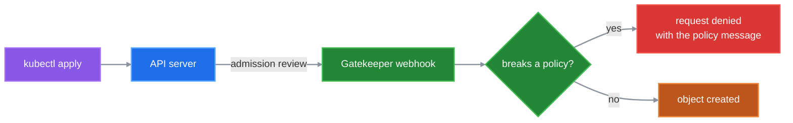

# OPA Gatekeeper Lab


Five security policies for Kubernetes, enforced by OPA Gatekeeper.
Each policy comes with a test manifest that breaks it, and one script proves the cluster rejects all of them.

**OPA Gatekeeper** is an admission controller: it checks every object sent to the Kubernetes API and refuses the ones that break a policy. Policies are written in **Rego**, the OPA policy language.

## Policies

| Policy | Rejects | Scope |
|---|---|---|
| `no-nodeport` | Services of type `NodePort` | cluster-wide* |
| `no-latest-tag` | containers using an image tagged `:latest` | cluster-wide* |
| `no-privileged` | containers with `privileged: true` | cluster-wide* |
| `require-limits` | containers without a CPU or memory limit | Pods in `prod` |
| `run-as-non-root` | containers not set to run as a non-root user | Pods in `prod` |

\* Except `kube-system`, `kube-flannel` and `gatekeeper-system`: kube-proxy and Flannel need privileged containers, and Gatekeeper must never block its own pods.

`run-as-non-root` accepts `runAsNonRoot: true` on the container, or on the Pod as long as the container does not set it back to `false`.

## Quick start

You need a Kubernetes cluster and `kubectl` 1.23 or newer with admin rights. From the repository root:

```bash
./scripts/install-gatekeeper.sh   # install Gatekeeper v3.14.2
./scripts/apply-policies.sh       # apply the five policies
./scripts/test-policies.sh        # prove they are enforced
```

The test script sends each test manifest to the cluster in dry-run mode, so **nothing is created**. Expected output (the order may vary):

```text
PASS  tests/no-nodeport.yaml
PASS  tests/no-latest-tag.yaml
PASS  tests/no-privileged.yaml
PASS  tests/require-limits.yaml
PASS  tests/run-as-non-root.yaml
```

If any manifest is accepted, the line shows `FAIL` with the cluster's answer, and the script exits with code 1.

**No cluster yet?** Use [ansible-kubeadm-cluster](https://github.com/raslenraslen/ansible-kubeadm-cluster), or run `bash cluster-k8s-shell/create-cluster.sh` on an Ubuntu VM. It builds a kubeadm 1.28 control plane node with containerd and Flannel, and prints the command to join workers.

## How it works



Each policy is two files:

| File | Kind | Role |
|---|---|---|
| `template.yaml` | ConstraintTemplate | **The rule**, written in Rego |
| `constraint.yaml` | Constraint | **Where and how** to apply it: kinds, namespaces, `enforcementAction: deny` |

A denied request looks like this:

```text
admission webhook "validation.gatekeeper.sh" denied the request: [no-privileged-containers] Container 'nginx' cannot run in privileged mode
```

## Repository layout

```text
policies/<policy>/template.yaml       the rule (Rego)
policies/<policy>/constraint.yaml     where and how it applies
tests/<policy>.yaml                   a manifest that must be rejected
scripts/install-gatekeeper.sh         installs Gatekeeper and waits until it is ready
scripts/apply-policies.sh             applies the templates, then the constraints
scripts/test-policies.sh              checks that every test manifest is rejected
cluster-k8s-shell/create-cluster.sh   optional: builds a kubeadm control plane node
```

## Audit existing resources

Policies also apply to resources that existed **before** them. Gatekeeper does not block those; it audits them every 60 seconds and reports the violations:

```bash
kubectl get constraints     # see the TOTAL-VIOLATIONS column
kubectl describe k8scontainernoprivileged no-privileged-containers   # one policy in detail
```

## Add a policy

1. Write `policies/<name>/template.yaml` and `policies/<name>/constraint.yaml`.
2. Write `tests/<name>.yaml`, a manifest that breaks this policy and no other.
3. Add the test file and its expected message to the `expected` list in `scripts/test-policies.sh`.
4. Run `./scripts/apply-policies.sh`, then `./scripts/test-policies.sh`.

## Remove everything

```bash
kubectl delete -f policies/ --recursive
kubectl delete -f https://raw.githubusercontent.com/open-policy-agent/gatekeeper/v3.14.2/deploy/gatekeeper.yaml
```

## Limitations

- Only the main containers are checked, not init or ephemeral containers.
- `no-latest-tag` does not catch an image with no tag at all (`nginx`), even though it also pulls `latest`.
- `require-limits` and `run-as-non-root` check Pods, not Deployments. A Deployment in `prod` is accepted, but its Pods are then refused: the reason appears in `kubectl describe replicaset`.
